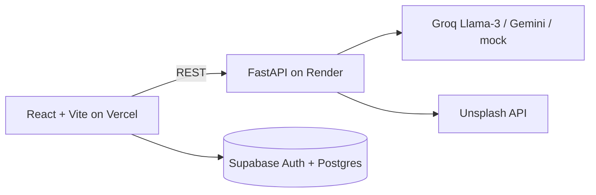

# ✈️ Personalized Travel Itinerary Planner
AI-powered full-stack app (React + FastAPI + Gemini/Llama-3 + Supabase schema) that generates day-by-day itineraries from destination, dates, budget, group, interests and pace.

## Scenarios
1. **Solo weekend getaway** – enter destination, budget, interests; get an optimized plan in seconds.
2. **Couple vacation** – relaxed pace, premium budget; edit activities and regenerate single days.
3. **Group trip** – set group size and shared interests; costs scale per group.

## Features
- Supabase Auth (email/password) + trips saved per user with Row Level Security (local demo mode if keys are missing)
- Dashboard: stat cards, search, open, duplicate, delete
- Smart Trip Builder: destination, dates, budget, group, traveler type, interests, pace, stay, transport
- Groq (Llama-3) generation by default (Gemini optional) with few-shot prompt, strict JSON, Pydantic validation, retry; mock mode with no key
- Itinerary view: day tabs, edit / add / remove activities, regenerate a single day, cost charts (per day and per category)
- Share trip via public read-only link, export to PDF (print), dark/light mode
- Unsplash destination photos (`/api/image`)

## Architecture


## Setup
```bash
cd backend && python -m venv venv && venv\Scripts\activate   # Mac/Linux: source venv/bin/activate
pip install -r requirements.txt && cp .env.example .env
uvicorn main:app --reload --port 8000
# new terminal
cd frontend && npm install && npm run dev
```
Open http://localhost:5173. Add `GROQ_API_KEY` (console.groq.com) in `backend/.env` for live AI; without it the app runs in mock mode. Run tests: `cd backend && pytest`.

## API
`GET /health` · `GET /api/image?query=` · `POST /api/generate-itinerary` · `POST /api/regenerate-day` · `GET/POST /api/trips` · `DELETE /api/trips/{id}` · `POST /api/trips/{id}/share` · `GET /api/shared/{token}`

## Env variables
| Var | Purpose |
|---|---|
| LLM_PROVIDER | `gemini` or `groq` |
| GROQ_API_KEY / GROQ_MODEL | Llama-3 via Groq (default provider) |
| GEMINI_API_KEY / GEMINI_MODEL | Optional Gemini |
| UNSPLASH_ACCESS_KEY | Destination photos |
| VITE_API_URL | Backend URL (frontend) |
| VITE_SUPABASE_URL / VITE_SUPABASE_ANON_KEY | Supabase auth + database (frontend) |

Supabase: create a project, run `supabase/schema.sql` in the SQL editor, then copy the URL and anon key into `frontend/.env`.

## Deployment
Backend on Render (root `backend`, build `pip install -r requirements.txt`, start `uvicorn main:app --host 0.0.0.0 --port $PORT`). Frontend on Vercel (root `frontend`, set `VITE_API_URL`).

## System requirements
4 GB+ RAM, Python 3.10+, Node 18+, internet for LLM API calls. No local ML models.
